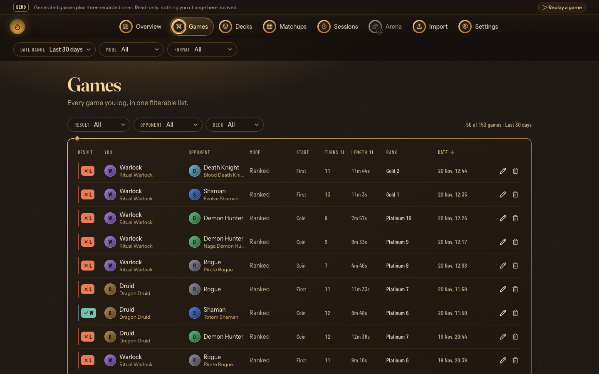
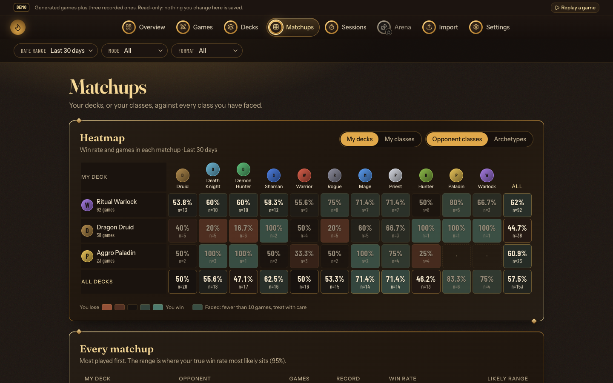
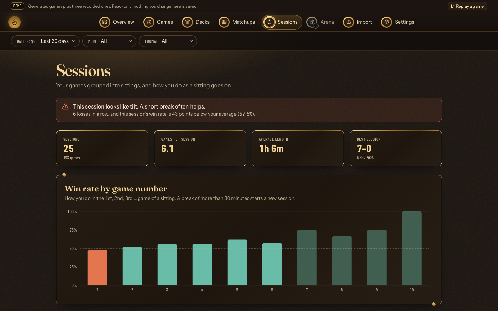
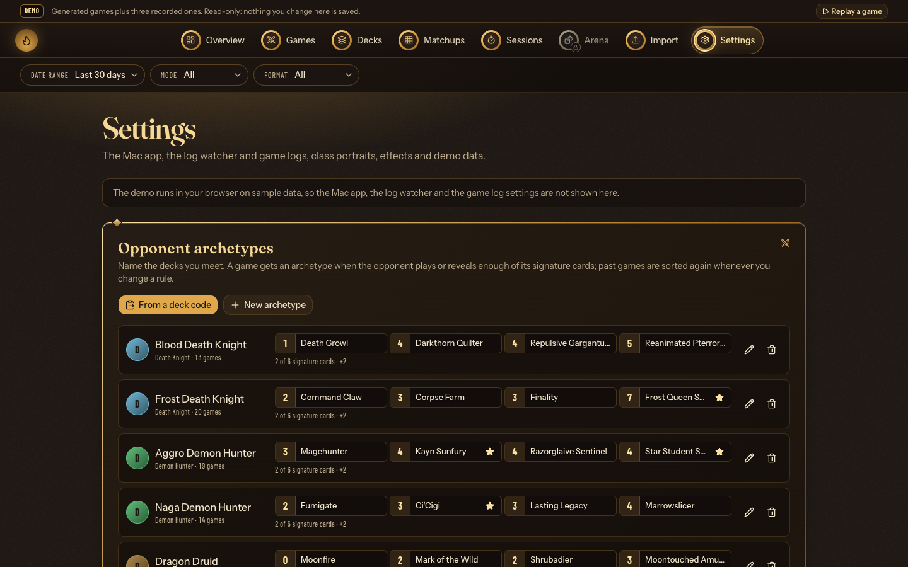
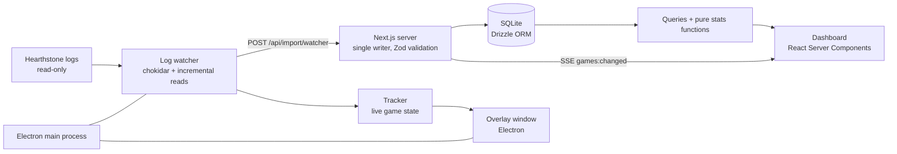

# Tavern Dashboard

[](https://github.com/MertTomak/tavern-dashboard/actions/workflows/ci.yml)

A local-first Hearthstone stats app for the Mac. It records your games from Hearthstone's own log files, turns them into statistics and plain-English insights, and shows an in-game deck tracker next to the board. Everything stays on your computer: no accounts, no cloud, no ads.

> **Try the demo:** _link coming soon_ (a read-only copy on generated data; no Mac or Hearthstone needed).

| | |
| - | - |
|  |  |
|  |  |

_Screenshots are from demo mode on generated data, with card art hidden. The live demo shows the full art._

## Why

Existing tools are either meta sites (what to play) or personal trackers that keep the deeper analysis behind a paywall or ads. This one is built around your own games:

- **Archetype-level matchups**, not just classes: how you do against Quest Hunter, not just "Hunter".
- **Insights in sentences** that interpret the numbers, and stay silent when there is too little data to say anything honest.
- **Zero friction**: games are saved automatically; Quick add takes seconds for anything played elsewhere.
- **Privacy**: your data lives in one folder on your disk.
- **Visual quality**: a dark "inside the tavern" design with an interactive 3D hero card, not a spreadsheet.

## Features

- **Automatic recording** from `Power.log` and `Decks.log` (read-only), with a menu-bar record of today's games.
- **Overview** with win rate, streaks, a Legend-rank estimate, recent games and a ranked climb chart, laid out as a horizontal journey.
- **Decks** with version history: a card change creates a new version and old stats are kept.
- **Matchups** heat map by class and archetype, built from the cards the opponent revealed.
- **Sessions** with tilt detection.
- **Deck tracker overlay**: your deck counting down as you draw, the odds of your next draw, and what the opponent has played or revealed. It only shows what a player can see in the game itself.
- **Import** from older `Power.log` files, with one-click undo per import.
- **Demo mode**: a generated dataset plus recorded games, replayed through the real tracker panels in the browser.

## How it works



Stats are always computed from the raw games; nothing is stored as a total. SQL lives only in `src/lib/db/queries/`, stats functions are pure and unit-tested, and every external input goes through Zod. Only one watcher runs at a time, guarded by a lock file.

## Run it

Requirements: Node 22+.

**Web, with the generated demo data (any OS):**

```bash
npm install
npm run dev:demo          # http://localhost:3001, read-only
```

**Web, with your own data (Mac, Hearthstone in `/Applications`):**

```bash
npm install
npm run cards:sync        # card data from HearthstoneJSON
npm run dev:all           # dashboard at http://localhost:3000 + log watcher
```

**Mac app (Apple Silicon):**

```bash
npm run app:build         # builds the app and installs it in /Applications
```

The app is not signed by Apple. If macOS refuses to open it, use System Settings › Privacy & Security › **Open Anyway**. On first run, approve the log settings in **Settings › Game logs** (it adds `[Power]` and `[Decks]` to Hearthstone's `log.config`), then restart Hearthstone.

Deck tracker: drag it by its header, resize with the bottom-left grip, hide or show with **⌥⌘T**. If it does not show over a fullscreen game, switch Hearthstone to Windowed mode.

Your data is stored in `~/Library/Application Support/TavernDashboard` (database, backups, card data, art). A backup is taken before every database update.

To deploy the web demo yourself, see [`docs/deploy-demo.md`](docs/deploy-demo.md).

## Tech stack

Next.js 16 (App Router, Cache Components) · React · TypeScript (strict) · Tailwind CSS · shadcn/ui (Base UI) · Recharts · Motion · Lenis · three.js with React Three Fiber · SQLite (better-sqlite3) · Drizzle ORM · Zod · chokidar · Electron · Vitest · Playwright · GitHub Actions.

## Testing

```bash
npm run typecheck && npm run lint && npm run test    # also what CI runs
npm run test:e2e                                      # Playwright
```

Unit tests cover the stats functions, the log parser (against anonymised real game logs), the watcher, the importer, deck matching, the tracker and the demo dataset. To try the tracker without the game, replay a recorded log: see `scripts/replay-log.ts`.

## Fair play

The app reads log files only. It never reads game memory, never automates or touches the game, and never logs in to Battle.net. Nothing on screen shows hidden information (the opponent's hand contents, deck order or unrevealed secrets), even where it could be inferred from the logs.

## Legal

Tavern Dashboard is an unofficial fan project for personal, non-commercial use. It is not affiliated with or endorsed by Blizzard Entertainment, Inc. Hearthstone® is a registered trademark of Blizzard Entertainment, Inc. Card data and card images come from [HearthstoneJSON](https://hearthstonejson.com) at run time; no Blizzard images are stored in this repository.
